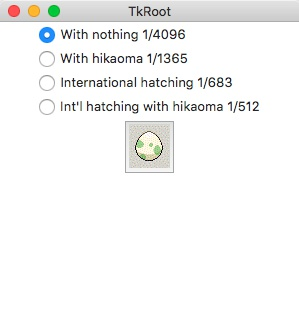
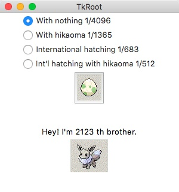

PokeShiny
===

色違いイーブイが何個目の卵で生まれるかシミュレートするだけのクソの役にも立たんプログラム。
しかし作るのは楽しい。

- Docker: 対応!
- Python: 3.15!
- Linter: Ruff!
- Test: pytest!
- GUI: tkinter!

## パッと実行してみたい

```bash
docker compose up --build
# ブラウザで http://localhost:6080/vnc.html?autoconnect=1 を開く
```

- GUI はコンテナ内で動く。ブラウザへの表示は noVNC。
- ポートの公開先は `127.0.0.1` のみ。
- 止めるときは `Ctrl+C`。





## 遊び方

1. 孵化の条件をラジオボタンで選ぶ。
2. 卵ボタンを押す。
3. 色違いが何番目の兄弟で生まれたかと、色違いイーブイが出る。

| 条件 | 色違いの確率 |
| --- | --- |
| With nothing | 1/4096 |
| With hikaoma | 1/1365 |
| International hatching | 1/683 |
| Int'l hatching with hikaoma | 1/512 |

## ターミナルで遊びたい

`--rate` を付けると GUI なしで孵化できる。値は色違いの確率 `x/4096` の `x` (1, 3, 6, 8) 。

```bash
docker compose run --rm app python poke_shiny.py --rate 8
# Hey! I'm 702nd brother.

# --times で何回も孵化して平均を出す
docker compose run --rm app python poke_shiny.py --rate 8 --times 1000
# Average: 512.3 eggs (1000 times)
```

## 開発

```bash
# ソースを変更したらイメージを作り直す
docker compose build

# lint と format チェック
docker compose run --rm app ruff check .
docker compose run --rm app ruff format --check .

# テスト (GUI テストは仮想ディスプレイ上で動く)
docker compose run --rm app xvfb-run -a pytest

# ブラウザ E2E (noVNC 越しに卵ボタンを押してスクリーンショットを撮る)
docker compose up -d --build
uv run --only-group e2e playwright install chromium
uv run --only-group e2e python e2e/novnc_check.py screenshots
docker compose down
```

- 依存関係の管理は [uv](https://docs.astral.sh/uv/) 。設定は `pyproject.toml` と `uv.lock`。
- tkinter が使える Python 3.15 があれば、ローカルで `uv run python poke_shiny.py` でも起動できる。
- CI (GitHub Actions) は Docker ビルド、 lint 、テスト、 GUI の起動確認、ブラウザ E2E 。スクリーンショットは artifact に残る。
